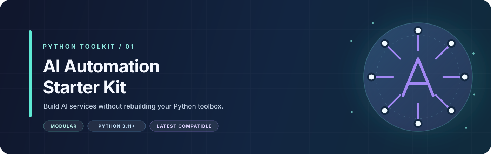

<p align="center">
  
</p>

<h1 align="center">AI Automation Starter Kit</h1>

<p align="center">
  A modular Python foundation for AI automations, agents, APIs, and background jobs.
</p>

<p align="center">
  
</p>

<p align="center">
  <a href="https://github.com/EdgeAgent/ai-automation-starter/actions/workflows/ci.yml"></a>
  <a href="https://www.python.org/"></a>
  
  
  <a href="LICENSE"></a>
</p>

**Start with one install, add only the stack you need, and run a real example.** The repository provides a small default Python foundation, focused optional dependency profiles, an `ai-starter` diagnostics CLI, and a runnable FastAPI + Redis/Celery + OpenAI job service.

> This is a starter project, not a hosted service or a turnkey production deployment. It installs Python packages and provides a tested example; Docker, Redis, provider accounts, credentials, infrastructure security, and production operations remain your responsibility.

## What you can do

- Install the shared Python foundations with `python -m pip install -e .`.
- Add profiles for model providers, agent frameworks, web automation, servers, data, vector stores, documents, workflows, or local ML.
- Run an authenticated API that queues prompts in Redis, has a Celery worker call OpenAI, and lets clients poll job status.
- Use `ai-starter profiles` to inspect install options and `ai-starter doctor --profile server` to check direct dependencies.
- Run the test suite without Redis, API keys, or paid model calls; queue and provider boundaries are replaced with fakes in tests.

## Install profiles

| Profile | Includes | Good for |
| --- | --- | --- |
| **Default install** | Pydantic/settings, dotenv, HTTPX, retries, structured logging, Typer, Rich, packaging | Common Python application foundations and the `ai-starter` CLI |
| `openai` | OpenAI Python SDK | The included AI-job example with one provider |
| `providers` | OpenAI, Anthropic, Google GenAI, LiteLLM | Projects that need several model-provider clients |
| `frameworks` | LangChain, LangGraph, LlamaIndex core | Agent and retrieval framework experiments |
| `automation` | Requests, Beautiful Soup, lxml, Playwright | HTTP jobs, scraping, and browser automation |
| `server` | FastAPI, Uvicorn, Gunicorn, SQLAlchemy, Alembic, Redis client, Celery, metrics, telemetry | APIs and long-running Python services |
| `data` | pandas, Polars, DuckDB, PyArrow | Data ingestion, transformation, and analytics |
| `vector` | Chroma, Qdrant, pgvector, Weaviate clients | Vector search and retrieval integrations |
| `documents` | PDF, Word, Excel, and PowerPoint libraries | Document import/export and processing |
| `workflows` | APScheduler, Prefect | Scheduled and orchestrated Python workflows |
| `all` | All runtime profiles, including the default foundation, except `dev` and heavyweight `ml` | A broad general-purpose toolbox |
| `dev` | pytest, coverage, Ruff, mypy, pre-commit | Developing and checking this repository |
| `ml` | PyTorch, Transformers, Sentence Transformers | Local model and embedding work; expect a much larger installation |

Versions are intentionally not pinned in this reusable kit: installers resolve the newest releases compatible with the current Python version and platform. The `all` extra is intentionally broad and may resolve hundreds of transitive packages. Prefer focused profiles for most projects; `all` excludes development-only tools and heavyweight local ML frameworks.

## Quick start: run the AI job service

The public repository is [EdgeAgent/ai-automation-starter](https://github.com/EdgeAgent/ai-automation-starter). You need Python 3.11+, Docker with the Compose plugin, and an OpenAI API key for the live model call.

```bash
git clone https://github.com/EdgeAgent/ai-automation-starter.git
cd ai-automation-starter
cp .env.example .env
```

Edit `.env` and replace the API-token and provider-key placeholders. Generate a high-entropy API token with:

```bash
python -c "import secrets; print(secrets.token_urlsafe(32))"
```

Never commit `.env`, share the real values in an issue, or place them in source code. Then start the API, worker, and Redis:

```bash
docker compose up --build
```

In a second terminal, submit a job (replace `<your-token>` with the token in `.env`):

```bash
curl -sS http://localhost:8000/v1/jobs \
  -H 'Authorization: Bearer <your-token>' \
  -H 'Content-Type: application/json' \
  -d '{"prompt":"Give me three ideas for automating invoice intake."}'
```

The API returns `202 Accepted` and a `job_id`. Poll the job by replacing `<job-id>` with the returned ID:

```bash
curl -sS http://localhost:8000/v1/jobs/<job-id> \
  -H 'Authorization: Bearer <your-token>'
```

The response moves through `queued` / `running` to `succeeded` or `failed`. Successful jobs return the model output. The API docs are at `http://localhost:8000/docs`; `/healthz` checks API liveness, while `/readyz` checks Redis readiness.

See [`examples/server/README.md`](examples/server/README.md) for non-Docker startup, endpoint details, and operational notes. Stop Compose with `Ctrl+C`, then run `docker compose down`. The named Redis volume is retained; remove it only if you intentionally want to discard local queued jobs and results.

## Profile diagnostics

After installing the repository, use its CLI from the project environment:

```bash
ai-starter profiles
ai-starter doctor
ai-starter doctor --profile server
ai-starter doctor --profile openai
ai-starter version
```

`doctor` checks the direct requirements declared for a profile, prints installed versions, and returns a non-zero exit code when required packages are missing. It does not check Redis availability, API credentials, transitive dependency health, or provider-account access; use `/readyz` for the example's Redis check.

## Other install paths

For the smaller API + OpenAI profile without Compose:

```bash
python -m pip install -e ".[openai,server]"
```

Start Redis separately, then run the worker and API in separate terminals:

```bash
celery -A examples.server.worker.celery_app worker --loglevel=INFO
uvicorn examples.server.app:app --reload
```

For browser automation, install its browser binary after the Python extra:

```bash
python -m pip install -e ".[automation]"
python -m playwright install chromium
```

On Linux, Playwright may also need operating-system libraries; see the [Playwright installation guide](https://playwright.dev/python/docs/intro). For a broad install, use `python -m pip install -e ".[all]"`.

## Develop and test

```bash
python -m pip install -e ".[openai,server,dev]"
ruff check .
ruff format --check .
pytest
```

The tests inject fake queue and provider clients. They make no calls to Redis or OpenAI and do not require secrets. The GitHub Actions workflow runs the checks on Python 3.11, 3.12, and 3.13.

## What the server example does—and does not do

The API requires an `Authorization: Bearer ...` token for job submission and status lookup. If `AI_STARTER_API_TOKEN` is missing, protected routes fail closed instead of accepting unauthenticated work. The API queues jobs; a separate Celery worker makes the provider call; Redis brokers the queue and temporarily stores results.

The example uses one shared bearer token, not user accounts or multi-tenant authorization. Before a real deployment, add identity and per-user access controls, rate limits and quotas, appropriate prompt/output retention, TLS and a reverse proxy, worker monitoring, secret rotation, and a tested rollback process. Review provider cost and data-retention policies before sending user data to a model. SQLAlchemy and other server libraries are available in the `server` profile, but this example does not create a database. Docker and Redis are separate services and are not installed by pip.

## Keeping dependencies current—and deployable

Refresh an existing environment with:

```bash
python -m pip install --upgrade --upgrade-strategy eager -e ".[openai,server]"
```

Unpinned dependencies are convenient for exploration, but new releases can introduce breaking changes. For an application you deploy, validate updates in CI and create an application-specific lock file or pinned requirements set. For example, use `uv lock` to create a lock and `uv lock --upgrade` when you intentionally refresh it. This starter's passing CI validates its tested profiles and examples; it does not prove that every possible combination of optional extras works together.

## Repository layout

```text
.
├── .github/workflows/ci.yml       # Python matrix tests and package build
├── assets/                        # Editable SVG icon and README banner
├── examples/server/               # FastAPI API, settings, Celery worker
├── src/ai_automation_starter/     # Package metadata and ai-starter CLI
├── tests/                         # CLI, API, worker, and metadata tests
├── .env.example                   # Safe configuration template
├── Dockerfile
├── compose.yaml                   # API + worker + Redis local stack
└── pyproject.toml                 # Package metadata and install profiles
```

## Contributing

Install the server, OpenAI, and development profiles, then run the checks above. Keep the default install lean, put specialized or heavyweight tools in their own extra, and update the README, profile tests, and changelog when changing groups. See [`CONTRIBUTING.md`](CONTRIBUTING.md).

## Repository and license

The source is public at [github.com/EdgeAgent/ai-automation-starter](https://github.com/EdgeAgent/ai-automation-starter). It is not published to PyPI; clone the repository and use the editable install commands above. Released under the [MIT License](LICENSE).
